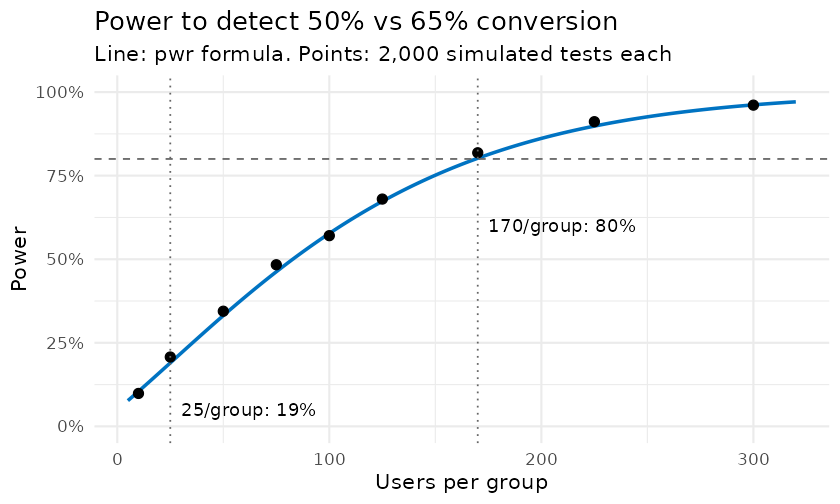
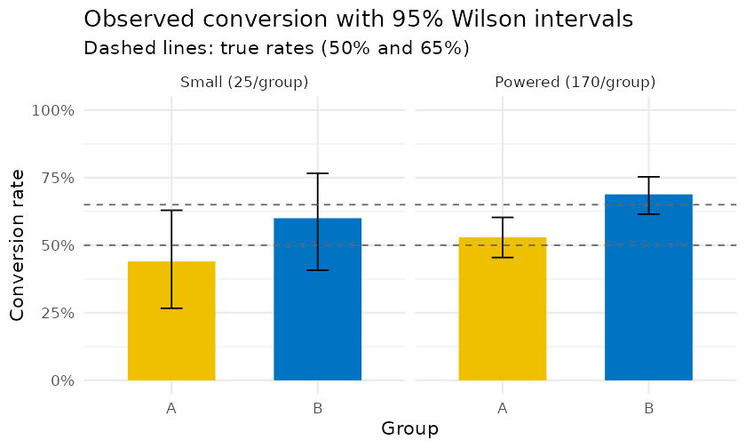

# A/B Test Power: How Sample Size Changes What a Test Can Detect

**R | power analysis | simulation**

If variant B truly converts at 65% and control A at 50%, how many users does an A/B test need to detect it, and what goes wrong with too few? This project answers that with `pwr` (Cohen's *h*) and checks the answer by Monte Carlo simulation. **Answer:** 170 users per group (340 total) for 80% power at α = 0.05. With 25 per group, power is only 19%: the test usually misses the real effect, and when it does reach significance it overstates the lift by about 2x. All data is simulated, so the true effect is known.

## Key results

Reproducible with `set.seed(2025)`; every number below is printed by the R Markdown report.

| Users per group | Power (`pwr` formula) | Power (2,000 simulated tests) | Avg. lift among significant results (true = 0.15) |
|---|---|---|---|
| 10 | 0.105 | 0.098 | 0.478 |
| 25 | 0.190 | 0.208 | 0.331 |
| **170** (planned) | **0.802** | **0.819** | **0.167** |



- **The formula holds up.** Simulated power matches `pwr.2p.test` from 10 to 300 users per group.
- **Underpowered tests fail twice.** They usually miss a real effect (Type II error), and the significant results they do produce exaggerate it ("winner's curse": exaggeration ratio 2.2 at 25 per group vs 1.1 at 170).
- **One experiment at each size** (the figure below): the small test estimated a lift of 0.16, close to the truth, but its 95% CI was −0.11 to 0.43 (p = 0.26), so it cannot distinguish "no effect" from "large effect". The powered test estimated 0.16 with CI 0.06 to 0.26 (p = 0.003).



## Method

1. **Design first.** Cohen's *h* for 50% vs 65% is 0.305. `pwr.2p.test()` gives power for a given *n* per group, or *n* per group for a target power (169.1, rounded **up** to 170).
2. **Simulation check.** At each sample size, 2,000 experiments are simulated and analysed with `prop.test(correct = FALSE)`. The share with p < 0.05 is the empirical power.
3. **Single experiments** reported as lift with a 95% confidence interval, not just a p-value.
4. **Winner's curse.** Among simulated significant results, compare the average estimated lift with the true 0.15.

Power is used only as a **design** quantity, computed from the assumed true effect. "Observed power" calculated from the effect seen in the data is a known fallacy (it is a function of the p-value) and is not reported.

## Run it

Requires R ≥ 4.3 and these CRAN packages: `pwr`, `dplyr`, `tidyr`, `ggplot2`, `knitr`, `rmarkdown`, `scales`.

```r
install.packages(c("pwr", "dplyr", "tidyr", "ggplot2", "knitr", "rmarkdown", "scales"))
rmarkdown::render("sample_size_impact_on_ab_testing.Rmd")   # writes the HTML report and figures/
```

Rendering takes about a minute (the simulations).

## Repository layout

```
├── sample_size_impact_on_ab_testing.Rmd   # the full analysis
├── figures/                                # figures written by the Rmd
├── README.md
└── LICENSE
```

## Limitations

- Simulated data with a large, known effect (15 points). Real conversion lifts are usually a few points or less, which needs thousands of users per group.
- One metric and a single, fixed-horizon analysis. Testing several metrics needs a multiple-comparison correction, and checking results before the planned sample size ("peeking") inflates false positives.

## Related

- [ml-model-ab-test-framework](https://github.com/lukahere007/ml-model-ab-test-framework): applies the same design-first workflow to comparing two ML models (accuracy and latency) in Python, with multiple-testing correction, a peeking simulation, and a unit-tested sample size function checked against `pwr`.
- An earlier version of this report is published on [RPubs](http://rpubs.com/lukahere007/ab-test-power-analysis).

## Author

Luke Wamalwa ([GitHub](https://github.com/lukahere007) | [LinkedIn](https://www.linkedin.com/in/luke-wamalwa-83962492/)). Part of my Data Science for Clinical Research portfolio.

## License

MIT
